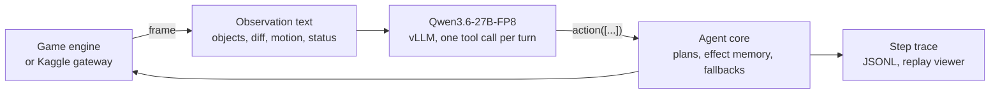

# solve-arc-agi-3

An agent that plays [ARC-AGI-3](https://three.arcprize.org) games with an open-weight 27B model (Qwen3.6-27B-FP8 on
vLLM), built to run offline on a Kaggle GPU for the ARC Prize 2026 competition.



## Status (2026-11-01)

- **Scores:** two Kaggle submissions, both **0.00** (refs 57788190, 57844835). Offline dry runs on 12 public games
  cleared 0 to 3 levels. We have never seen the logs of a competition rerun, so the cause is unknown
  ([`docs/baselines/baseline-report.md`](docs/baselines/baseline-report.md)).
- **What works:** the pinned offline stack, the agent loop, per-step traces with a browser replay viewer, a free
  scripted client, and Haiku-via-[semula](https://github.com/leejianrong/semula) players for behaviour tests.
- **What does not:** the agent plays movement games close to random and rarely finds a goal. The hypothesis
  ledger, world model and planner exist but are off by default and unproven on real games.
- Public notebooks from the top teams use a stronger model, images and thinking; see
  [`docs/baselines/kaggle-submission-checklist.md`](docs/baselines/kaggle-submission-checklist.md).

## Quick start

Needs [uv](https://docs.astral.sh/uv/) and, for the local games, the sibling repo `../play-arc-agi-3` with its `.venv`.

```sh
make install    # uv sync
make check      # ruff, mypy --strict, pytest (no GPU, no network)

# free scripted client through the real agent and scorer, with traces
PYTHONPATH=src ../play-arc-agi-3/.venv/bin/python scripts/local_play.py \
  --fake --games 6 --steps 60 --trace-dir /tmp/traces
```

Open `tools/replay/index.html` in a browser, choose the run folder under `/tmp/traces`, and step through the game.

## Usage

- **Compare variants on Kaggle (free GPU):** `scripts/kaggle_dev.sh <name> ARC3_NAV=1`, then
  `python3 scripts/summarize_run.py build/dev-runs/<name>`.
- **Behaviour tests with Haiku players:** [`docs/SEMULA-HAIKU-LOOP.md`](docs/SEMULA-HAIKU-LOOP.md); compare runs with
  `scripts/bench_summary.py label=dir ...`.
- **Failure clusters of a run:** `PYTHONPATH=src python3 scripts/cluster_failures.py <trace dir>`.
- **Switches (all off by default):** `ARC3_LEDGER`, `ARC3_NAV`, `ARC3_EVENTS`, `ARC3_TOOLS`, `ARC3_WORLD_MODEL`,
  `ARC3_PROMPT_CHARS`. They are read in `src/solve_arc_agi_3/kaggle_agent.py`.

## Credentials and rented compute

`make check` needs none. Copy [`.env.example`](.env.example) to `.env` for Kaggle and RunPod keys and source it yourself.
Never call a hosted model API: tests of model behaviour use semula and Haiku. RunPod jobs follow
[`AGENTS.md`](AGENTS.md) and start with `scripts/runpod_launch_lab.sh` plus its `watch` command.

## Docs

[`docs/PLAN.md`](docs/PLAN.md) (design), [`docs/SLICES.md`](docs/SLICES.md) (what is built), [`docs/adr/`](docs/adr/)
(decisions), [`docs/TRACE.md`](docs/TRACE.md) (trace format), [`AGENTS.md`](AGENTS.md) (how agents work here).

## Contributing

A personal competition entry. Work happens on `feat/` branches and lands through pull requests; see
[`AGENTS.md`](AGENTS.md). Issues are welcome.

## License

Apache License 2.0, see [`LICENSE`](LICENSE). The Duck harness behaviour is reimplemented, not vendored; see
[`docs/adr/0011-duck-as-pinned-control-not-application-framework.md`](docs/adr/0011-duck-as-pinned-control-not-application-framework.md).
