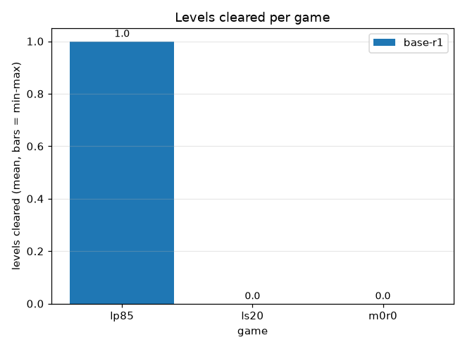
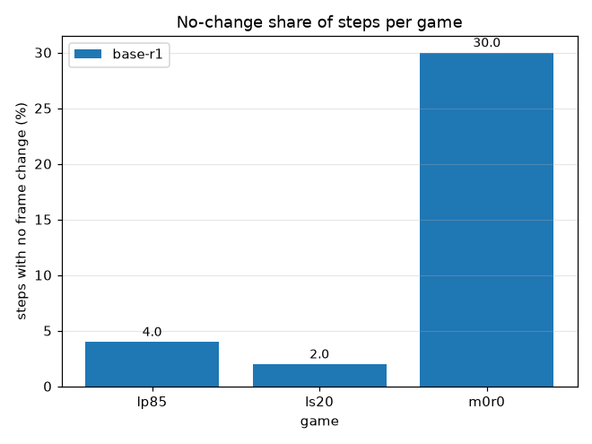
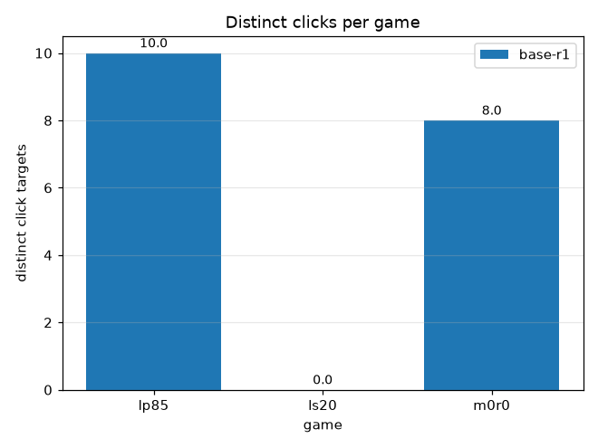
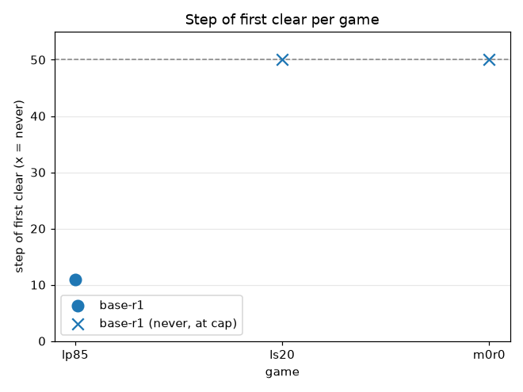
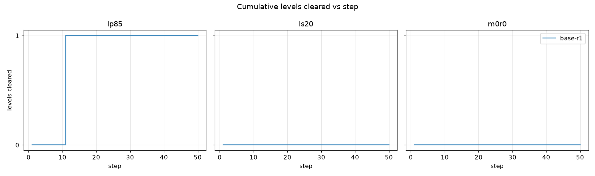
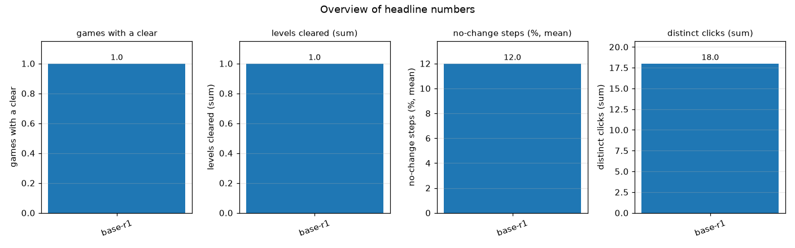

# Haiku base-r1: lp85, ls20, m0r0 (nav off)

## Question

Can the Haiku players clear levels in these games, and how do the variants (labels) differ? Which games give them trouble and what do the failures look like?

## Setup

- Labels: base-r1 (1 run)
- Games: lp85, ls20, m0r0
- Step cap: 50 actions per game (longest trace)
- Players: Haiku subagents driving the game through semula (docs/SEMULA-HAIKU-LOOP.md); no hosted model API.

## Results

```
== base-r1: 1 run(s), 3 game(s)
game  steps  levels  1st clear  no-chg %  clicks  idle rep  fall %  over %  prob %  cluster
lp85  50     1       11         4.0       10      1         0.0     0.0     0.0     cleared
ls20  50     0       -          2.0       0       1         0.0     0.0     0.0     goal
m0r0  50     0       -          30.0      8       2         14.0    0.0     0.0     runtime
ALL (steps/levels/clicks summed, shares and 1st clear averaged, idle rep is the max): steps=150, levels=1, 1st clear=11, no-chg %=12.0, clicks=18, idle rep=2, fall %=4.7, over %=0.0, prob %=0.0, games with a clear=1
```













## Findings

- base-r1: best game lp85 (1.0 levels), worst ls20 (0.0); 1/3 games cleared a level; highest no-change share m0r0 (30% of steps).

## Limits

- One to a few runs per label and three games: differences are anecdotes, not measurements.
- Haiku players sometimes stopped early, so step counts understate what a full run would do.
- Traces are capped, and clearing earlier is rewarded by the score, which these charts do not compute.
- Distinct clicks and no-change share come from the trace; they say what was tried, not why.

## What we saw

Written by hand from the Haiku players' reports. On lp85 the player cleared level 1 by repeatedly clicking the left side block at (4,32); a continuation player used 32 answers in total, and level 2 stayed unsolved. On ls20 nothing was cleared in about 25+3 answers; the goal is still unknown, and the timer bar shrinks by one column per action. On m0r0 nothing was cleared: ACTION5 and most clicks do nothing. Players stopped early several times, and traces are capped at 50 actions per game (`--steps 50`).
