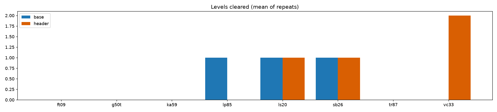
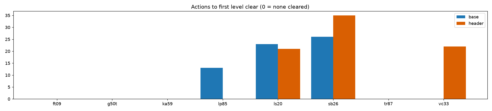

# S1: Franzen's Duck harness with and without our STATUS header (Haiku player, 40 actions)

| label | game | runs | levels | first clear (actions) | actions used | score |
|---|---|---|---|---|---|---|
| base | ft09 | 1 | 0.0/6 | - | 40 | 0.00 |
| base | g50t | 1 | 0.0/7 | - | 40 | 0.00 |
| base | ka59 | 1 | 0.0/7 | - | 40 | 0.00 |
| base | lp85 | 1 | 1.0/8 | 13 | 40 | 2.78 |
| base | ls20 | 1 | 1.0/7 | 23 | 40 | 3.27 |
| base | sb26 | 1 | 1.0/8 | 26 | 40 | 1.33 |
| base | tr87 | 1 | 0.0/6 | - | 40 | 0.00 |
| base | vc33 | 1 | 0.0/7 | - | 40 | 0.00 |
| header | ft09 | 1 | 0.0/6 | - | 40 | 0.00 |
| header | g50t | 1 | 0.0/7 | - | 40 | 0.00 |
| header | ka59 | 1 | 0.0/7 | - | 40 | 0.00 |
| header | lp85 | 1 | 0.0/8 | - | 40 | 0.00 |
| header | ls20 | 1 | 1.0/7 | 21 | 40 | 3.57 |
| header | sb26 | 1 | 1.0/8 | 35 | 40 | 0.73 |
| header | tr87 | 1 | 0.0/6 | - | 40 | 0.00 |
| header | vc33 | 1 | 2.0/7 | 22 | 40 | 8.58 |

 

## What this shows, and what it does not

One Haiku player run per cell, 40 actions each, 8 games, 16 runs (about 1.7M player tokens in total, measured from the 16 player reports). The header run of `lp85` is the second one; the first was given a hint by mistake and is left out.

- Totals: baseline cleared 3 levels (mean score 0.92), header cleared 4 (mean score 1.61). The difference comes almost entirely from `vc33` (2 levels with the header, 0 without) and `lp85` (1 without, 0 with). With one run per cell and mostly zeros, **this is noise, not an effect.** `lp85` alone flipped from 1 level to 0 between two header runs that differed only by player luck.
- Both labels cleared nothing on `ft09`, `g50t`, `ka59`, `tr87`. A 40-action cap with a player that must first discover the controls leaves too little room; probing no-ops costs budget.
- Not measured: anything about Qwen on Kaggle. Haiku here is only a behaviour probe. The real test is a Franzen-copy notebook with `ARC3_STATUS_HEADER=1` against the 25-game base25 run.

## Header bugs found by the players

Reported independently by players on 8 games. Fix these before putting the header in a notebook:

1. The mover guess follows an object by colour and mislabels it: a size-1 cell, an animation frame, or a second same-coloured piece (`tr87`, `ka59`, `g50t`).
2. State is not reset on level change or game over: stale "clicks that changed the board" (`vc33`), "no object has been seen moving yet" after a cleared level (`ls20`), a pre-reset move reported after GAME OVER (`lp85`).
3. In click-only games the "controlled object" line is noise (`lp85`, `ft09`, `sb26`), and "BLOCKED (nothing changed)" is wrong for clicks that animate the board (`ft09`).
4. After SPACE switches the controlled piece, the reported move is attributed to the wrong piece (`g50t`).

The tried-actions, no-op warning and BLOCKED lines for arrow moves were reported accurate by every player.

## Harness notes for the next Duck run

- Pending calls expire after 300s in semula; a player must be running before the run starts.
- A no-op move stops the rest of a batch; a batch that clears a level loses its remaining actions.
- Players must answer with an action every time (a print-only answer costs a call but no action) and may not judge the run over by their own action count.
