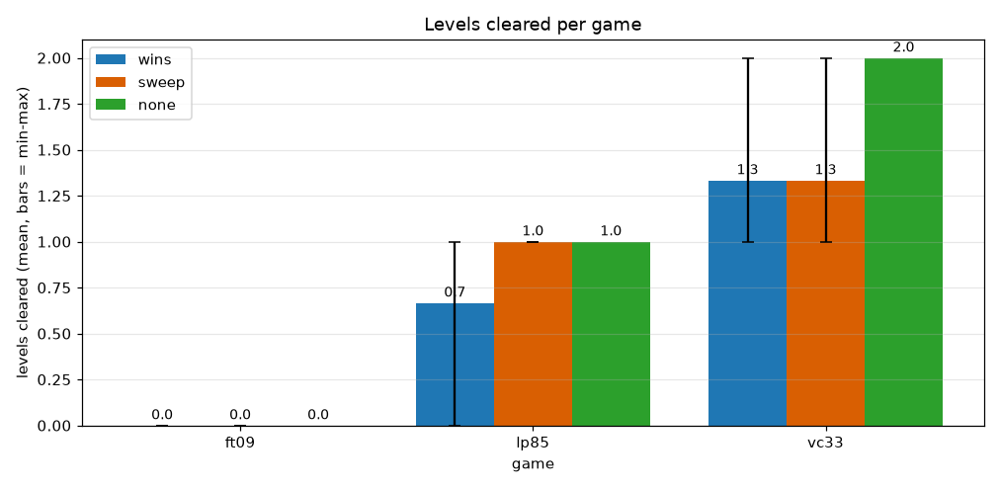
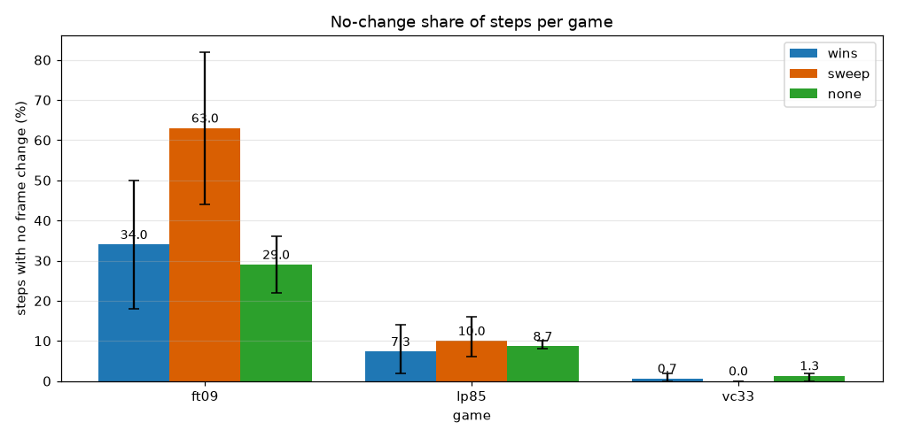
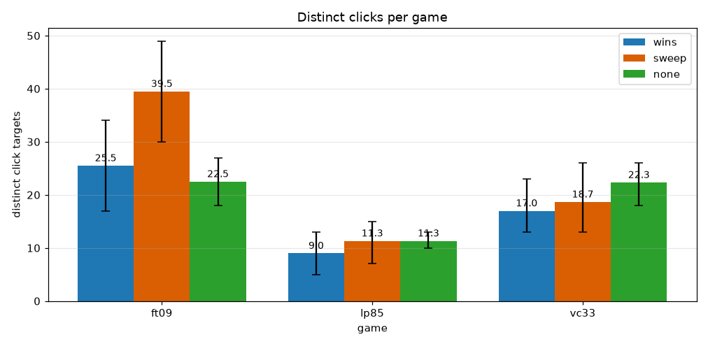
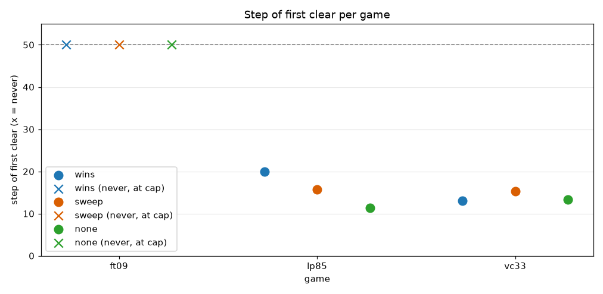
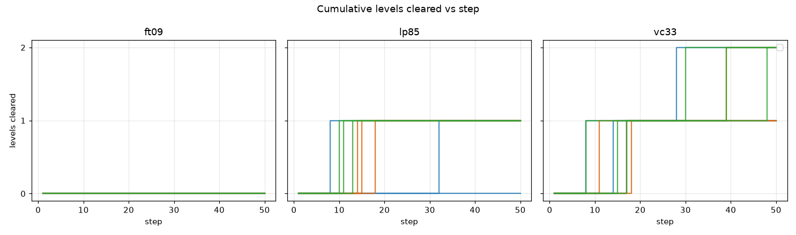
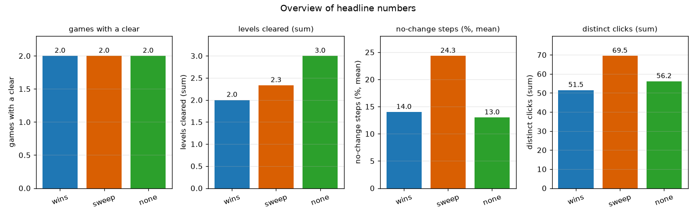

# S2: click guidance (wins vs sweep vs none)

## Summary (written by hand)

Three click-guidance modes in our own agent's status header (`ARC3_CLICK_HINTS`): `wins` (list of clicks that changed the board), `sweep` (always list objects not clicked yet), `none` (neither). Same Haiku players, 50 steps per game, lp85 and vc33 with 3 repeats, ft09 with 2 (it scored 0 in all six runs, so the third repeat was dropped).

- **No mode is better.** Levels cleared per game: lp85 1/1/1 (wins 0-1, sweep 1, none 1), vc33 1.3/1.3/2.0 for wins/sweep/none. The spread between repeats of one mode (0 to 2 levels on lp85 and vc33) is as large as the spread between modes. `none` leading is not a result.
- **One real signal, still small:** on ft09 `sweep` wasted more steps (63% of steps changed nothing, against 29% for `none` and 34% for `wins`). ft09 responds to only a few clicks inside one frame, so listing every unclicked object sends the player to dead cells. Two runs per mode, so a hint, not a measurement.
- **What the players asked for instead, in all 24 runs:** no mode says what the goal is, which cells are buttons, or what the shrinking bar means. The status line also keeps naming the level-1 "controlled object" after a level change (our agent's header, not yet fixed; the Duck header got that fix in PR #9). Next study should test a short rules line, not another click list.
- **Cost:** about 100k Haiku tokens per run, roughly 2.4M for the 24 runs counted here, plus about 0.35M for a first attempt that crashed and is excluded (a third parked call outlived semula's 300 s limit while two players were busy; fixed by one game per run).
- Scores are not in the table below. Game scores were 0 to 8.5 out of 100; nothing here moves the leaderboard.

## Question

Can the Haiku players clear levels in these games, and how do the variants (labels) differ? Which games give them trouble and what do the failures look like?

## Setup

- Labels: wins (8 runs), sweep (8 runs), none (8 runs)
- Games: ft09, lp85, vc33
- Step cap: 50 actions per game (longest trace)
- Players: Haiku subagents driving the game through semula (docs/SEMULA-HAIKU-LOOP.md); no hosted model API.

## Results

```
== wins: 8 run(s), 3 game(s)
game  steps       levels   1st clear        no-chg %          clicks      idle rep  fall %         over %         prob %         cluster
ft09  50 (50-50)  0 (0-0)  -                34.0 (18.0-50.0)  26 (17-34)  1 (1-1)   0.0 (0.0-0.0)  0.0 (0.0-0.0)  0.0 (0.0-0.0)  goal 2/2
lp85  50 (50-50)  1 (0-1)  20 (8-32) n=2/3  7.3 (2.0-14.0)    9 (5-13)    1 (1-1)   0.0 (0.0-0.0)  0.0 (0.0-0.0)  0.0 (0.0-0.0)  cleared 2/3
vc33  50 (50-50)  1 (1-2)  13 (8-17)        0.7 (0.0-2.0)     17 (13-23)  0 (0-1)   0.0 (0.0-0.0)  0.0 (0.0-0.0)  0.0 (0.0-0.0)  cleared 3/3
ALL (steps/levels/clicks summed, shares and 1st clear averaged, idle rep is the max): steps=50 (50-50), levels=1 (0-2), 1st clear=16 (8-32) n=5/8, no-chg %=11.5 (0.0-50.0), clicks=16 (5-34), idle rep=1 (0-1), fall %=0.0 (0.0-0.0), over %=0.0 (0.0-0.0), prob %=0.0 (0.0-0.0), games with a clear=1 (0-1)

== sweep: 8 run(s), 3 game(s)
game  steps       levels   1st clear   no-chg %          clicks      idle rep  fall %         over %         prob %         cluster
ft09  50 (50-50)  0 (0-0)  -           63.0 (44.0-82.0)  40 (30-49)  1 (1-1)   0.0 (0.0-0.0)  0.0 (0.0-0.0)  0.0 (0.0-0.0)  perception 1/2
lp85  50 (50-50)  1 (1-1)  16 (14-18)  10.0 (6.0-16.0)   11 (7-15)   1 (1-1)   0.0 (0.0-0.0)  0.0 (0.0-0.0)  0.0 (0.0-0.0)  cleared 3/3
vc33  50 (50-50)  1 (1-2)  15 (11-18)  0.0 (0.0-0.0)     19 (13-26)  0 (0-0)   0.0 (0.0-0.0)  0.0 (0.0-0.0)  0.0 (0.0-0.0)  cleared 3/3
ALL (steps/levels/clicks summed, shares and 1st clear averaged, idle rep is the max): steps=50 (50-50), levels=1 (0-2), 1st clear=16 (11-18) n=6/8, no-chg %=19.5 (0.0-82.0), clicks=21 (7-49), idle rep=1 (0-1), fall %=0.0 (0.0-0.0), over %=0.0 (0.0-0.0), prob %=0.0 (0.0-0.0), games with a clear=1 (0-1)

== none: 8 run(s), 3 game(s)
game  steps       levels   1st clear   no-chg %          clicks      idle rep  fall %         over %         prob %         cluster
ft09  50 (50-50)  0 (0-0)  -           29.0 (22.0-36.0)  22 (18-27)  1 (1-1)   0.0 (0.0-0.0)  0.0 (0.0-0.0)  0.0 (0.0-0.0)  goal 2/2
lp85  50 (50-50)  1 (1-1)  11 (10-13)  8.7 (8.0-10.0)    11 (10-13)  1 (1-1)   0.0 (0.0-0.0)  0.0 (0.0-0.0)  0.0 (0.0-0.0)  cleared 3/3
vc33  50 (50-50)  2 (2-2)  13 (8-17)   1.3 (0.0-2.0)     22 (18-26)  1 (0-1)   0.0 (0.0-0.0)  0.0 (0.0-0.0)  0.0 (0.0-0.0)  cleared 3/3
ALL (steps/levels/clicks summed, shares and 1st clear averaged, idle rep is the max): steps=50 (50-50), levels=1 (0-2), 1st clear=12 (8-17) n=6/8, no-chg %=11.0 (0.0-36.0), clicks=18 (10-27), idle rep=1 (0-1), fall %=0.0 (0.0-0.0), over %=0.0 (0.0-0.0), prob %=0.0 (0.0-0.0), games with a clear=1 (0-1)
```













## Findings

- wins: best game vc33 (1.3 levels), worst ft09 (0.0); 2/3 games cleared a level; highest no-change share ft09 (34% of steps).
- sweep: best game vc33 (1.3 levels), worst ft09 (0.0); 2/3 games cleared a level; highest no-change share ft09 (63% of steps).
- none: best game vc33 (2.0 levels), worst ft09 (0.0); 2/3 games cleared a level; highest no-change share ft09 (29% of steps).
- Label difference: none cleared the most levels in total (wins=2.0, sweep=2.3, none=3.0). Treat this as a hint only: n is tiny and a single run is noisy.

## Limits

- One to a few runs per label and three games: differences are anecdotes, not measurements.
- Haiku players sometimes stopped early, so step counts understate what a full run would do.
- Traces are capped, and clearing earlier is rewarded by the score, which these charts do not compute.
- Distinct clicks and no-change share come from the trace; they say what was tried, not why.
